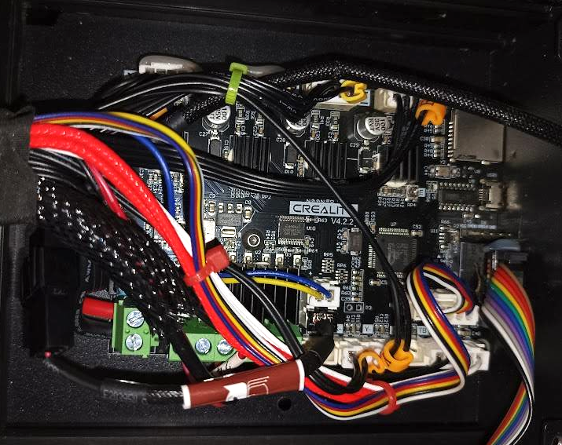

# Marlin 2.0.9.1 – Custom Firmware für den Creality Ender 3 Pro

 🇩🇪 **Dies ist die deutsche Dokumentation.** 
 
 🇬🇧 👉 For the English version, please view the [README_EN.md](README_EN.md).
 
Dieses Repository enthält eine angepasste **Marlin 2.0.9.1** Firmware für den **Creality Ender 3 Pro** mit **v4.2.2 Mainboard (GD32F303-RET6)**, CR-Touch und BMG-Extruder.

Die ursprüngliche Basis dieser Konfiguration stammt aus dem Repository von [Christopher Kurtin](https://github.com/criskurtin/Marlin).

---

## 🛠️ Anpassungen & Features

Folgende Funktionen und Optimierungen sind bereits aktiviert bzw. vorkonfiguriert:

### ✅ CR-Touch / BLTouch aktiviert
Automatische Bettnivellierung (ABL) ist vollständig eingerichtet und einsatzbereit.

 

### ✅ Bett-Schrauben-Assistent aktiviert
Der **ASSISTED_TRAMMING_WIZARD** unterstützt das manuelle Ausrichten des Druckbetts. In Verbindung mit dem BLTouch werden die Positionen über den Bettschrauben automatisch angefahren und vermessen. Der Assistent zeigt anschließend die notwendigen Korrekturen zum exakten Trammen des Druckbetts an.

 

### ✅ BMG-Extruder vorkonfiguriert
Die Extruder-Schritte wurden auf **415 Steps/mm** angepasst (`DEFAULT_AXIS_STEPS_PER_UNIT`) und sind für Bondtech BMG Extruder sowie kompatible Klone ausgelegt.

 

### ✅ Linear Advance aktiviert
**Linear Advance** (`LIN_ADVANCE`) ist aktiviert und kann bequem über den G-Code `M900` konfiguriert werden. Dadurch wird der Materialfluss insbesondere bei Beschleunigungs- und Richtungswechseln deutlich präziser geregelt.

 

### ✅ Reduzierte Extruder-Beschleunigung
Die maximale Extruder-Beschleunigung wurde auf **500 mm/s²** reduziert, um unnötige Belastungen von Filament, Extruder und Zahnradmechanik zu vermeiden.

 

### ✅ Filamentwechsel aktiviert
Unterstützung für automatischen und manuellen Filamentwechsel während des Drucks oder direkt über das LCD-Menü im Idle-Betrieb.

 

### ✅ PID-Autotuning aktiviert
PID-Werte für Hotend und Heizbett können direkt per G-Code oder im LCD-Menü neu eingemessen werden.

 

### ✅ Advanced Pause Feature aktiviert
Erweiterte Pausen-, Park- und Filamentwechsel-Funktionen (`ADVANCED_PAUSE_FEATURE`) sind aktiviert.

 

### ✅ Host Action Commands aktiviert
Verbesserte Kommunikation mit Host-Systemen wie **OctoPrint**. Unterstützt Status-, Pausen- und Fortsetzen-Meldungen direkt vom Drucker an den Host.

 

### ✅ Restzeitanzeige & Fortschrittsbalken aktiviert
Die LCD-Anzeige zeigt während des Drucks einen Fortschrittsbalken sowie die verbleibende Druckzeit an. Dadurch lässt sich der aktuelle Druckfortschritt jederzeit direkt am Drucker überwachen.

 

### ✅ Optimierte Vorheizprofile
Der veraltete Vorheiz-Eintrag **ABS** wurde durch **PETG** ersetzt.

Vorkonfigurierte Temperaturen:

| Material | Düse | Heizbett |
|-----------|-----------|-----------|
| PLA | 195°C | 60°C |
| PETG | 220°C | 75°C |

 

### ✅ Angepasste Druckbettgröße
Die nutzbare Druckfläche wurde auf **230 × 220 mm** eingestellt.

---

## 📦 Hardware-Voraussetzungen

- **Drucker:** Creality Ender 3 Pro
- **Mainboard:** Creality v4.2.2 (GD32F303-RET6) mit A4988-Schrittmotortreibern
- **LCD:** Original Creality LCD mit japanischem Zeichensatz
- **Sensor:** Creality CR-Touch oder BLTouch
- **Extruder:** BMG Dual-Drive Extruder (oder kompatibler Klon)

---

## 🚀 Installation (Fertige Firmware flashen)

Eine eigene Kompilierung ist nicht notwendig.

1. Öffne den Bereich **Releases** auf GitHub.
2. Lade die aktuelle Datei `firmware-xxxx.bin` herunter.
3. Verwende eine leere, mit **FAT32** formatierte MicroSD-Karte.
4. **Wichtig für GD32-Boards:** Benenne die Firmware-Datei vor dem Flashen um (z. B. `Marlin_BMG_v1.bin` oder `firmware_20261023.bin`). Bereits verwendete Dateinamen werden vom Bootloader teilweise ignoriert.
5. Kopiere die umbenannte Datei direkt in das Hauptverzeichnis der SD-Karte.
6. Schalte den Drucker aus.
7. Stecke die SD-Karte ein.
8. Schalte den Drucker wieder ein. Während des Flash-Vorgangs bleibt das Display für einige Sekunden leer. Anschließend startet der Drucker automatisch neu.

### EEPROM zurücksetzen (erforderlich)

Nach dem ersten Start sollten die neuen Standardwerte aus der Firmware ins EEPROM übernommen werden:

1. **Configuration → Restore Defaults**
2. **Configuration → Store Settings**

Dadurch werden alte Einstellungen entfernt und alle in der Firmware hinterlegten Werte übernommen.

### Z-Offset einstellen

1. Führe zunächst ein **Auto Home** aus.
2. Stelle anschließend unter **Configuration → Probe Z-Offset** den korrekten Düsenabstand ein.
3. Speichere den Wert mit **Store Settings** dauerhaft im EEPROM.

---

## 🔨 Firmware selbst kompilieren

Zum Kompilieren wird **Visual Studio Code** mit den Erweiterungen **PlatformIO** und **Auto Build Marlin** empfohlen.

1. Repository klonen oder als ZIP herunterladen.
2. Das Projekt in Visual Studio Code öffnen.
3. Gewünschte Anpassungen in `Configuration.h` und `Configuration_adv.h` vornehmen.
4. Die Firmware über **Auto Build Marlin** oder **PlatformIO** erstellen.
5. Die erzeugte `.bin`-Datei aus `.pio/build/...` auf eine FAT32-formatierte MicroSD-Karte kopieren.
6. Die Datei vor dem Flashen umbenennen (siehe Hinweis zu GD32-Boards).
7. Die Firmware wie oben beschrieben flashen.

### Nach dem Flashen

#### EEPROM zurücksetzen

1. **Configuration → Restore Defaults**
2. **Configuration → Store Settings**

Dadurch werden die in der Firmware hinterlegten Standardwerte übernommen.

#### Z-Offset einstellen

1. **Auto Home** ausführen.
2. **Probe Z-Offset** einstellen.
3. Mit **Store Settings** speichern.

---

## 💡 Nützliche G-Code-Befehle

|> Die folgenden Befehle können über OctoPrint, Pronterface, Repetier-Host oder ein anderes Terminal direkt an den Drucker gesendet werden.

| Funktion | Befehl | Beispiel | Beschreibung |
|-----------|---------|---------|---------|
| Auto Home | `G28` | `G28` | Fährt alle Achsen (X, Y, Z) an ihre Endstopps und setzt die aktuelle Position als Referenz. |
| Automatische Bettnivellierung (ABL) | `G29` | `G29` | Startet das automatische Bed-Leveling mittels BLTouch/CR-Touch. |
| Bett-Schrauben-Assistent (Bed Tramming) | `G35` | `G35` | Vermisst die Positionen über den Bettschrauben und zeigt an, welche Schraube wie weit gedreht werden muss. |
| Düsentemperatur setzen | `M104` | `M104 S200` | Heizt die Düse auf 200 °C, ohne auf das Erreichen der Temperatur zu warten. |
| Düsentemperatur setzen und warten | `M109` | `M109 S200` | Heizt die Düse auf 200 °C und wartet, bis die Zieltemperatur erreicht ist. |
| Betttemperatur setzen | `M140` | `M140 S60` | Heizt das Druckbett auf 60 °C, ohne zu warten. |
| Betttemperatur setzen und warten | `M190` | `M190 S60` | Heizt das Druckbett auf 60 °C und wartet auf die Zieltemperatur. |
| Bauteillüfter einschalten | `M106` | `M106 S255` | Schaltet den Bauteillüfter ein. Wertebereich: 0–255. |
| Bauteillüfter ausschalten | `M107` | `M107` | Schaltet den Bauteillüfter vollständig aus. |
| Filamentwechsel | `M600` | `M600` | Pausiert den Druck und startet den Filamentwechsel-Assistenten. |
| Filament laden | `M701` | `M701` | Lädt Filament automatisch in den Extruder. |
| Filament entladen | `M702` | `M702` | Entlädt Filament automatisch aus dem Extruder. |
| Druck pausieren und parken | `M125` | `M125` | Pausiert den Druck und fährt den Druckkopf in eine Parkposition. |
| Pause fortsetzen | `M108` | `M108` | Bricht bestimmte Wartezustände ab bzw. setzt pausierte Vorgänge fort. |
| Steps/mm einstellen | `M92` | `M92 E415.0` | Setzt die Schritte pro Millimeter für Achsen oder Extruder. |
| Z-Offset einstellen | `M851` | `M851 Z-1.45` | Legt den Abstand zwischen Düse und Z-Sonde fest. |
| Linear Advance K-Faktor | `M900` | `M900 K0.22` | Setzt den Linear-Advance-Wert für einen präziseren Materialfluss. Mit `M900` ohne Parameter wird der aktuelle Wert angezeigt. |
| PID-Autotune Hotend | `M303` | `M303 E0 S200 C8 U1` | Führt eine automatische PID-Kalibrierung des Hotends bei 200 °C durch. |
| PID-Autotune Heizbett | `M303` | `M303 E-1 S70 C8 U1` | Führt eine automatische PID-Kalibrierung des Heizbetts bei 70 °C durch. |
| Einstellungen speichern | `M500` | `M500` | Speichert alle aktuellen Einstellungen dauerhaft im EEPROM. |
| Einstellungen laden | `M501` | `M501` | Lädt die gespeicherten EEPROM-Werte in den RAM. |
| Werkseinstellungen laden | `M502` | `M502` | Lädt die Standardwerte aus der Firmware in den RAM. Danach mit `M500` speichern, falls dauerhaft gewünscht. |
| Einstellungen anzeigen | `M503` | `M503` | Gibt alle aktuell aktiven Einstellungen im Terminal aus. |
| EEPROM prüfen | `M504` | `M504` | Prüft das EEPROM auf Erreichbarkeit und korrekte Prüfsumme. |

- Nach Änderungen an M92, M851, M900 oder PID-Werten immer mit M500 speichern.
- Anschließend mit M503 kontrollieren, ob die Werte korrekt übernommen wurden.
- Nach M502 sind die Firmware-Standardwerte nur im RAM geladen. Erst M500 schreibt sie dauerhaft ins EEPROM.

---

## 📋 Wichtige Firmware-Werte

| Einstellung | Wert |
|------------|------|
| Druckbett X | 230 mm |
| Druckbett Y | 220 mm |
| Extruder Steps/mm | 415 |
| Extruder Max Acceleration | 500 mm/s² |
| Auto Bed Leveling (BLTouch / CR-Touch) | Aktiv |
| Assisted Tramming Wizard | Aktiv |
| Linear Advance | Aktiv |
| Advanced Pause | Aktiv |
| Host Action Commands | Aktiv |
| PID Autotune | Aktiv |
| Fortschrittsbalken | Aktiv |
| Restzeitanzeige | Aktiv |
| Filamentwechsel (M600) | Aktiv |
| LCD-Menü Filament laden / entladen | Aktiv |
| Vorheizprofil ABS | Durch PETG ersetzt |
| Vorheizprofil PLA | 195 °C / 60 °C |
| Vorheizprofil PETG | 220 °C / 75 °C |

---

## 📜 Credits

- Originales Marlin-Projekt: https://github.com/MarlinFirmware/Marlin
- Basis-Konfiguration: https://github.com/criskurtin/Marlin

---

## ⚠️ Haftungsausschluss

Die Nutzung dieser Firmware erfolgt auf eigene Verantwortung.

Vor dem ersten Homing sollten folgende Punkte überprüft werden:

- Achsenrichtungen
- Endstop-Funktion
- CR-Touch-Funktion
- Z-Offset

Für Schäden an Hardware, Druckobjekten oder Folgeschäden wird keine Haftung übernommen.
